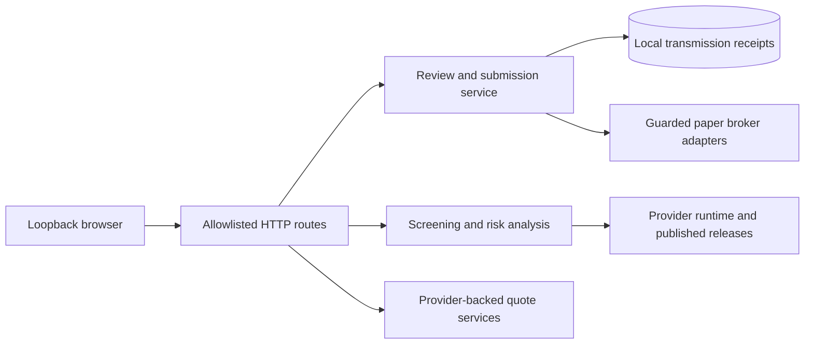

# Architecture

## Responsibilities

| Layer | Owning source | Responsibility |
| --- | --- | --- |
| UI | `apps/trading_web/static/` | Navigation, draft state, quotes, evidence presentation and explicit order review |
| HTTP | `apps/trading_web/server.py`, `http_base.py` | Loopback service, allowlisted routes, Host/Origin/token checks |
| Order lifecycle | `service.py`, `tickets.py`, `submissions.py` | Validate exact legs, prepare short-lived reviews, durable transmission receipts |
| Brokers | `alpaca.py`, `ibkr*.py` | Paper account guards, execution adapters and separate market-data dispatch |
| Analysis | `apps/screener/`, `apps/plan/`, `apps/trade_profile/` | Saved screens, portfolio scenarios, trading-log analysis and reports |
| Provider | Editable sibling `data_providers` | Source adapters, releases, shared storage, runtime configuration and pricing |

The many compatibility modules in `compute/`, `data/`, `datasources/`, `shared/` and `scripts/` alias provider implementations. Their presence does not mean source data is owned here. `bootstrap.ROOT` resolves this application's source/output; `bootstrap.DATA_ROOT` delegates to provider runtime configuration. Bootstrap pins process time to UTC; UI display time explicitly uses Asia/Shanghai.

## Design rationale

A draft stays in browser memory. Collapsing it changes layout without resetting its legs or review; Research hides it temporarily. An account change clears the draft and invalidates its review to prevent cross-account reuse. Reloading the page loses the draft. There is no durable draft recovery feature.

RiskUI owns its loading flag, generation and account/draft signature. Successes and errors from an old generation are discarded. Rendering checks loading and broker compatibility so another UI update cannot enable an unavailable action. This protects presentation; server-side account/ticket validation remains authoritative.

A review token expires after 120 seconds and is held only in process memory. Submission derives an idempotent client reference from that token and records `submitting` before broker transmission. Explicit rejections and uncertain transport outcomes are different states. Persistence lets the service reconcile acknowledged broker orders after a lost HTTP response. See [recovery](OPERATIONS.md#submission-recovery).

Market data is separate from paper execution. The IBKR quote gateway is not an implicit execution fallback. Bounded caches and source fallback improve response handling but never establish quote freshness; event and receipt times remain separate.

## Deliberate limits

The server is a local application, not a multi-user authentication service. It has no TLS/public hosting, scheduler deployment, remote-user isolation or automatic trade decision engine. No current source evidence validates exposing it outside loopback. CI verifies code with synthetic/private-data skips; it does not operate gateways or deploy a site.
